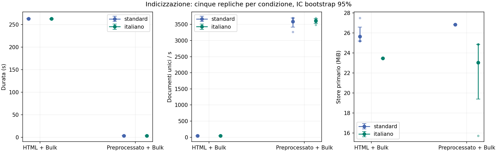
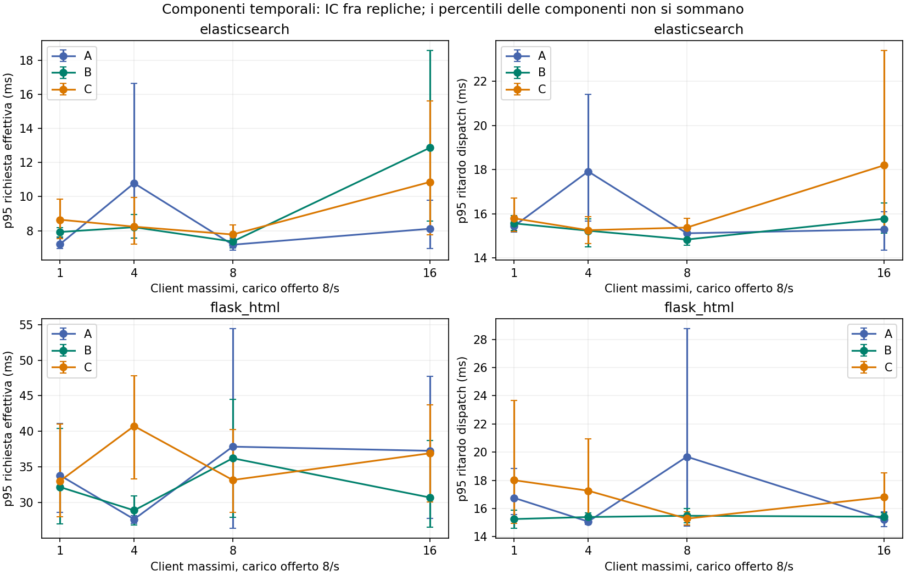

> Vista consultabile: soltanto i cinque collegamenti alle figure sono stati adattati al nuovo percorso. Originale immutato: [EXPERIMENT_REPORT_20261118.original.txt](EXPERIMENT_REPORT_20261118.original.txt). Provenienza in `../SOURCE.json`.

# Benchmark sperimentale Wikinews Elasticsearch

Data: 18 novembre 2026, Europe/Rome. Seed: **20261118**. Output esterno al repository: `C:\Users\proti\AppData\Local\Temp\wikinews-benchmark-20261118`.

## Stato delle prove

- Preprocessing completo effettivamente eseguito: 12257 operazioni valide; 12261 record letti; scarti `{'short_text': 3, 'redirect': 1}`. Durata ausiliaria 266.725 s, una sola esecuzione, non una replica dell'indicizzazione.
- Indicizzazione: **20/20** esecuzioni registrate, 20 completate senza eccezione.
- Ricerca: **240/240** celle completate; **1,336,275** richieste misurate, **2** errori registrati. Warm-up esclusi dai CSV.
- Ranking: workload e intenti prefissati, pooling A/B/C e file ciechi disponibili se `blind_candidates.jsonl` è presente. **Nessuna valutazione umana eseguita, nessun risultato di rilevanza umana disponibile.**

## Vincoli e conservazione

Non sono stati eseguiti comandi Git, né modificati file applicativi. Non è stata usata `evaluation.prepare`, `indexer.create_index` o `build_index`, perché la creazione applicativa può cancellare un indice omonimo. Il caricatore esterno verifica l’assenza del nome e usa esclusivamente CREATE e Bulk su nomi `wnbench_20261118_<uuid>_<analyzer>`. Tutti i nuovi indici sono conservati. Dopo ciascuna misura si chiude solo il nuovo indice per liberare risorse; alla fine se ne riaprono due per la ricerca. Gli altri diciotto restano recuperabili con OPEN. Gli indici preesistenti non sono chiusi, riscritti o ricostruiti.

I precedenti manifest, run, candidati e template sono copiati byte per byte in `preserved/`; i loro hash e quelli dei sorgenti sono nel manifest. `preservation_check.json` verifica gli hash finali. Le copie conservate non vengono reinterpretate come ground truth umana. Il precedente benchmark aveva una sola preparazione per analyzer e latenze su 27 query diagnostiche con recupero del testo integrale: non viene mescolato alle nuove misure.

## Provenienza e ambiente

Dump: `C:\Users\proti\Desktop\dev\wikinews-search-elasticsearch\data\itwikinews-NS0-20250320-ENTERPRISE-HTML.json.tar.gz`; SHA-256 `d2c00ef9d7c3db5a3f26adb85b07055673b30b2417653374ada52b7174df474d`. Documenti preprocessati: SHA-256 `05478325f03155e68eda84515b76e6610b77911eaa78aea9ac0e4870220396e9`. Il file conserva ordine e ID ripetuti del dump; Bulk `index` applica la stessa semantica di sovrascrittura del codice esistente. `corpus_equality.json` verifica count e hash delle sorgenti finali dei due indici utilizzati per la ricerca.

CPU: Intel(R) Core(TM) i7-9700K CPU @ 3.60GHz; 8 processori logici. RAM host: 15.93 GiB. Sistema: Microsoft Windows 11 Pro 10.0.26300. Python: 3.10.0. Librerie: `{'elasticsearch': '8.19.3', 'Flask': '3.1.3', 'beautifulsoup4': '4.15.0', 'lxml': '6.1.3'}`.

Elasticsearch 8.15.0, Lucene 9.11.1, singolo nodo Docker, heap massimo 1 GiB. Stesso cluster per ogni condizione, 1 shard primario e 0 repliche; mapping identico salvo l’analyzer sperimentalmente manipolato. Similarità BM25 predefinita, senza override. Analyzer `italiano` è il custom dell’applicazione (elisione, lowercase, stopword italiane, asciifolding, light stemmer), non il built-in `italian`. Configurazioni: A standard, campi title/body uniformi; B italiano, campi uniformi; C stesso indice di B con title^3. `cluster_before.json`, `cluster_after.json`, `hardware.json` e `docker_hostconfig.json` conservano dettagli e configurazioni effettive.

All’inizio Docker era spento ed Elasticsearch rifiutava la connessione. È stato avviato Docker Desktop, quindi il solo container esistente `wikinews-es`, preservandone il volume. Il preflight ha riscontrato circa 5 s per aprire una connessione con localhost contro circa 0,019 s con 127.0.0.1: l’endpoint numerico è stato fissato prima delle prove. Non è una stima della latenza di ricerca. Il pool client usa 32 connessioni per nodo, per non limitare a dieci i sedici client.

Nessun altro carico pesante è stato avviato dall’esperimento durante le misure. Un controllo CPU dei processi prima dell’avvio è in `host_preflight_cpu.json`; il maggior consumo osservato nel breve preflight era inferiore all’1% dell’host per processo. L’host resta una workstation condivisa: l’assenza continuativa di interferenze esterne non è garantibile. La RAM libera iniziale era bassa. La telemetria registra memoria disponibile e CPU host oltre ai dati ES; l’isolamento non equivale a una macchina dedicata. Nei log Docker iniziali sono presenti avvisi di arretramento dell’orologio assoluto della VM: le durate client usano `perf_counter`, non l’orologio civile.

## Esperimento 1: protocollo

`workload.json` è stato scritto e hashato prima di misurare: SHA-256 `5cd4a571d485506ed27d9813f86cf78e3d7df00406ccf6dd7916c00eefd6a6c7`. 94 query **sintetiche**, selezionate deliberatamente a quote senza log utenti né consultazione dei nuovi ranking. 14 per nomi propri, eventi, generiche, flessioni, accenti e frasi; 10 ambigue. Nessuna corrispondenza esatta con le 27 diagnostiche. I temi possono sovrapporsi. Non si assume rappresentatività delle ricerche reali. Per la validazione sono prefissate 18 query e relativi intenti, distinte dalle 27 diagnostiche e deliberatamente condivise con parte del workload prestazionale.

Disegno a cinque blocchi completi randomizzati con seed fisso. Ogni blocco contiene tutte le 48 combinazioni di percorso, scenario, configurazione e concorrenza; `search_schedule.json` è congelato prima delle misure. Client: 1, 4, 8, 16. Per ogni cella: attesa della fine di merge e indicizzazione, 32 richieste seriali di warm-up non misurate, poi fase di misura. Si usa cache naturalmente calda; non si svuotano cache, non si forza merge. Warm-up seriale parziale e cache tra repliche sono limiti espliciti: non si tratta di latenza a freddo o di riavvii indipendenti del cluster.

Scenario a carico controllato: 96 richieste, arrivi deterministici ogni 125 ms, **8 richieste/s aggregate** per tutte le configurazioni, anche cambiando il numero massimo di client. La coda client è esplicita. `client_ms` misura dalla scadenza di invio programmata al completamento, quindi include attesa in coda; `service_ms` dall’avvio effettivo al completamento; `queue_ms` registra il ritardo di dispatch. Questa scelta evita di nascondere il ritardo del generatore quando il carico eccede la capacità. La misura termina dopo il completamento di tutte le richieste: il throughput realizzato può scendere sotto 8/s e, per la convenzione temporale della prima richiesta a t=0, essere leggermente sopra 8/s se tutte terminano prima dei 12 s.

Scenario di capacità: client in ciclo chiuso senza think time per 30 s, poi drain delle richieste in corso. Il throughput è il numero di successi diviso il tempo trascorso effettivo, drain incluso. Si contano anche tre finestre contigue da 10 s. Una cella soddisfa il criterio operativo prefissato se p95 client ≤500 ms, errori ≤1%, CV del throughput delle tre finestre ≤0,15. Si riporta la capacità sostenuta osservata alle concorrenze provate: **30 s non dimostrano la capacità massima assoluta o la stabilità per ore**. Il ciclo chiuso descrive anche la backpressure; il test a frequenza controllata è il confronto primario delle latenze a parità di carico.

Payload diretto: `searcher.build_body`, pagina 1, size 10, track_total_hits, ordinamento stabile per article_id, highlight e faccette normali; `_source` title/url/date/category/lead. Non si recupera body nei test di latenza. `request_cache=false` su entrambi i percorsi. Le richieste del pool, separate dal benchmark, recuperano il testo integrale per la valutazione.

Percorso end-to-end: vero HTTP loopback verso `/` di Flask, inclusi routing, parsing, ricerca, trasformazione dei risultati, rendering HTML e trasferimento della risposta; nessun browser, TLS o WAN. Si usa `create_app` non modificata, servita da Werkzeug threaded. Un adapter client esterno seleziona i campi A/B/C e un hook esterno espone `took` in un header. Questi elementi e il generatore sono sullo stesso host; il throughput comprende i loro limiti e non rappresenta un deployment di produzione. I processi Flask vengono arrestati a fine test.

Il tempo Elasticsearch `took` è quello dichiarato dal server, in millisecondi interi, distinto dalla durata client. Non include rete, deserializzazione e rendering. Errori diretti includono eccezioni, timeout ES e shard falliti; per Flask si registrano errori HTTP/connessione/header. La normale app può restituire risultati parziali senza trasformare un timeout ES in errore HTTP: questo è un limite della classificazione end-to-end.

## Esperimento 1: risultati effettivi

| Percorso | Scenario | Client massimi | Config | Repliche | p50 richiesta ms | p95 richiesta ms | p95 dal programmato ms | req/s | Errori |
| --- | --- | --- | --- | --- | --- | --- | --- | --- | --- |
| elasticsearch | controlled | 1 | A | 5 | 5.19 | 7.22 | 21.11 | 8.07 | 0 |
| elasticsearch | controlled | 1 | B | 5 | 5.73 | 7.93 | 21.63 | 8.07 | 0 |
| elasticsearch | controlled | 1 | C | 5 | 5.74 | 8.65 | 22.15 | 8.08 | 0 |
| elasticsearch | controlled | 4 | A | 5 | 5.88 | 10.79 | 26.64 | 8.07 | 0 |
| elasticsearch | controlled | 4 | B | 5 | 5.71 | 8.21 | 21.52 | 8.07 | 0 |
| elasticsearch | controlled | 4 | C | 5 | 5.64 | 8.24 | 22.12 | 8.07 | 0 |
| elasticsearch | controlled | 8 | A | 5 | 5.24 | 7.18 | 20.94 | 8.07 | 0 |
| elasticsearch | controlled | 8 | B | 5 | 5.36 | 7.37 | 20.76 | 8.07 | 0 |
| elasticsearch | controlled | 8 | C | 5 | 5.80 | 7.78 | 21.59 | 8.07 | 0 |
| elasticsearch | controlled | 16 | A | 5 | 5.44 | 8.12 | 22.28 | 8.07 | 0 |
| elasticsearch | controlled | 16 | B | 5 | 6.26 | 12.87 | 27.59 | 8.07 | 0 |
| elasticsearch | controlled | 16 | C | 5 | 5.97 | 10.86 | 27.78 | 8.08 | 0 |
| elasticsearch | capacity | 1 | A | 5 | 4.80 | 6.86 | 6.86 | 203.74 | 0 |
| elasticsearch | capacity | 1 | B | 5 | 5.45 | 7.75 | 7.75 | 177.06 | 0 |
| elasticsearch | capacity | 1 | C | 5 | 5.28 | 7.64 | 7.64 | 181.16 | 0 |
| elasticsearch | capacity | 4 | A | 5 | 5.77 | 9.57 | 9.57 | 659.00 | 0 |
| elasticsearch | capacity | 4 | B | 5 | 6.34 | 10.30 | 10.30 | 597.93 | 0 |
| elasticsearch | capacity | 4 | C | 5 | 5.96 | 9.72 | 9.73 | 639.60 | 0 |
| elasticsearch | capacity | 8 | A | 5 | 9.85 | 18.50 | 18.50 | 767.71 | 0 |
| elasticsearch | capacity | 8 | B | 5 | 9.63 | 17.05 | 17.05 | 787.82 | 0 |
| elasticsearch | capacity | 8 | C | 5 | 9.85 | 20.14 | 20.14 | 723.04 | 0 |
| elasticsearch | capacity | 16 | A | 5 | 18.43 | 34.56 | 34.56 | 825.33 | 0 |
| elasticsearch | capacity | 16 | B | 5 | 17.14 | 32.37 | 32.37 | 872.09 | 0 |
| elasticsearch | capacity | 16 | C | 5 | 20.24 | 40.08 | 40.08 | 764.09 | 0 |
| flask_html | controlled | 1 | A | 5 | 23.56 | 33.82 | 45.84 | 8.07 | 0 |
| flask_html | controlled | 1 | B | 5 | 24.24 | 32.19 | 43.93 | 8.06 | 0 |
| flask_html | controlled | 1 | C | 5 | 24.26 | 33.05 | 45.95 | 8.06 | 0 |
| flask_html | controlled | 4 | A | 5 | 23.65 | 27.67 | 39.94 | 8.06 | 0 |
| flask_html | controlled | 4 | B | 5 | 20.05 | 28.91 | 39.97 | 8.07 | 0 |
| flask_html | controlled | 4 | C | 5 | 25.12 | 40.75 | 50.84 | 8.06 | 0 |
| flask_html | controlled | 8 | A | 5 | 22.16 | 37.86 | 51.96 | 8.07 | 0 |
| flask_html | controlled | 8 | B | 5 | 22.86 | 36.23 | 47.69 | 8.06 | 0 |
| flask_html | controlled | 8 | C | 5 | 24.17 | 33.18 | 44.61 | 8.07 | 0 |
| flask_html | controlled | 16 | A | 5 | 24.05 | 37.27 | 47.57 | 8.06 | 0 |
| flask_html | controlled | 16 | B | 5 | 24.12 | 30.72 | 42.94 | 8.06 | 0 |
| flask_html | controlled | 16 | C | 5 | 22.80 | 36.93 | 47.99 | 8.06 | 0 |
| flask_html | capacity | 1 | A | 5 | 12.77 | 31.77 | 31.77 | 65.59 | 0 |
| flask_html | capacity | 1 | B | 5 | 18.32 | 39.10 | 39.10 | 47.38 | 0 |
| flask_html | capacity | 1 | C | 5 | 18.93 | 37.39 | 37.39 | 48.73 | 0 |
| flask_html | capacity | 4 | A | 5 | 23.11 | 39.88 | 39.88 | 161.18 | 1 |
| flask_html | capacity | 4 | B | 5 | 22.13 | 36.21 | 36.21 | 171.73 | 0 |
| flask_html | capacity | 4 | C | 5 | 23.62 | 40.96 | 40.96 | 158.84 | 0 |
| flask_html | capacity | 8 | A | 5 | 44.86 | 65.69 | 65.69 | 173.80 | 0 |
| flask_html | capacity | 8 | B | 5 | 48.14 | 72.08 | 72.08 | 161.43 | 0 |
| flask_html | capacity | 8 | C | 5 | 48.21 | 74.89 | 74.89 | 160.20 | 1 |
| flask_html | capacity | 16 | A | 5 | 93.90 | 133.02 | 133.02 | 166.59 | 0 |
| flask_html | capacity | 16 | B | 5 | 96.82 | 132.26 | 132.26 | 160.06 | 0 |
| flask_html | capacity | 16 | C | 5 | 101.67 | 141.55 | 141.55 | 152.76 | 0 |

Le colonne p50/p95 sono medie dei percentili calcolati separatamente per replica, non percentili di tutte le richieste aggregate. IC e SD sono in `search_summary.csv`; differenze B−A e C−B appaiate per replica in `search_effects.csv`. I tempi `took` hanno righe dedicate nel riepilogo. I grafici mostrano anche i punti delle singole repliche.

| Percorso | Config | Client | Repliche con criterio soddisfatto | Repliche | Max req/s osservato |
| --- | --- | --- | --- | --- | --- |
| elasticsearch | A | 1 | 5 | 5 | 216.99 |
| elasticsearch | A | 4 | 5 | 5 | 803.67 |
| elasticsearch | A | 8 | 5 | 5 | 946.01 |
| elasticsearch | A | 16 | 5 | 5 | 1000.09 |
| elasticsearch | B | 1 | 5 | 5 | 191.51 |
| elasticsearch | B | 4 | 5 | 5 | 698.96 |
| elasticsearch | B | 8 | 5 | 5 | 974.02 |
| elasticsearch | B | 16 | 4 | 5 | 1021.20 |
| elasticsearch | C | 1 | 5 | 5 | 188.25 |
| elasticsearch | C | 4 | 5 | 5 | 730.65 |
| elasticsearch | C | 8 | 3 | 5 | 803.02 |
| elasticsearch | C | 16 | 5 | 5 | 932.95 |
| flask_html | A | 1 | 3 | 5 | 74.68 |
| flask_html | A | 4 | 5 | 5 | 170.02 |
| flask_html | A | 8 | 5 | 5 | 184.28 |
| flask_html | A | 16 | 5 | 5 | 184.43 |
| flask_html | B | 1 | 5 | 5 | 52.81 |
| flask_html | B | 4 | 5 | 5 | 183.95 |
| flask_html | B | 8 | 5 | 5 | 187.89 |
| flask_html | B | 16 | 5 | 5 | 168.83 |
| flask_html | C | 1 | 3 | 5 | 57.15 |
| flask_html | C | 4 | 5 | 5 | 174.16 |
| flask_html | C | 8 | 5 | 5 | 176.05 |
| flask_html | C | 16 | 5 | 5 | 165.00 |

La colonna massima è descrittiva e non va interpretata come throughput garantito. Usare distribuzione, finestre e criteri per replica in `search_cells.json`, senza selezionare il solo caso migliore.

## Esperimento 2: protocollo e risultati

Due fasi distinte: (1) creazione indice + lettura/decompressione dump + parsing HTML con codice esistente + Bulk + refresh esplicito; (2) creazione indice + lettura/decodifica dello stesso `preprocessed.jsonl` + Bulk + refresh. La seconda fase esclude parsing HTML ma include I/O e decodifica JSON, non misura il solo lavoro server. Chunk Bulk=500; retry automatici disabilitati. Refresh periodico disabilitato durante il caricamento, identico per entrambe le condizioni; ripristinato a 1 s dopo la misura. La flush viene misurata separatamente ed esclusa dalla durata principale. Store primario misurato subito dopo flush; nessun force-merge. Differenze di segmentazione e merge rendono la dimensione un punto operativo, non una dimensione minima teorica.

Cinque ripetizioni per analyzer in ciascuna fase, indici nuovi a ogni esecuzione, ordine Standard/italiano alternato per coppia. Con un numero dispari di coppie il primo analyzer compare tre volte per primo e l’altro due. Le due fasi sono eseguite in blocchi, senza inferire causalmente il costo del parsing per semplice sottrazione tra fasi. Le cache filesystem non vengono svuotate. Nessuna indicizzazione durante le prove di ricerca.

Ogni caricamento riproduce tutte le operazioni, incluse quelle con ID già incontrato. `operations` conta successi Bulk; `documents` conta i documenti unici finali. `docs_s` usa i documenti unici; il tasso operazioni/s è ricavabile da operations/duration_s. Gli errori Bulk sono riportati separatamente dalle eccezioni del run.

| Pipeline | Analyzer | Metrica | n | Media | SD | IC95 basso | IC95 alto |
| --- | --- | --- | --- | --- | --- | --- | --- |
| pipeline | standard | duration_s | 5 | 263.32 | 1.14 | 262.48 | 264.30 |
| pipeline | standard | docs_s | 5 | 46.37 | 0.20 | 46.20 | 46.51 |
| pipeline | standard | store_bytes | 5 | 26896245.40 | 1081875.43 | 26412416.00 | 27863904.20 |
| pipeline | standard | bulk_errors | 5 | 0.00 | 0.00 | 0.00 | 0.00 |
| pipeline | italiano | duration_s | 5 | 262.93 | 0.92 | 262.10 | 263.63 |
| pipeline | italiano | docs_s | 5 | 46.43 | 0.16 | 46.31 | 46.58 |
| pipeline | italiano | store_bytes | 5 | 24608672.00 | 0.00 | 24608672.00 | 24608672.00 |
| pipeline | italiano | bulk_errors | 5 | 0.00 | 0.00 | 0.00 | 0.00 |
| preprocessed | standard | duration_s | 5 | 3.41 | 0.19 | 3.30 | 3.58 |
| preprocessed | standard | docs_s | 5 | 3586.36 | 184.96 | 3417.37 | 3696.33 |
| preprocessed | standard | store_bytes | 5 | 28127730.00 | 0.00 | 28127730.00 | 28127730.00 |
| preprocessed | standard | bulk_errors | 5 | 0.00 | 0.00 | 0.00 | 0.00 |
| preprocessed | italiano | duration_s | 5 | 3.38 | 0.08 | 3.33 | 3.45 |
| preprocessed | italiano | docs_s | 5 | 3610.56 | 84.97 | 3536.20 | 3671.69 |
| preprocessed | italiano | store_bytes | 5 | 24162914.20 | 4284914.01 | 20330370.60 | 26079186.00 |
| preprocessed | italiano | bulk_errors | 5 | 0.00 | 0.00 | 0.00 | 0.00 |

Le differenze appaiate italiano−standard per durata, documenti/s e store sono in `indexing_effects.csv`. Tutte le 20 misure singole, indici e messaggi di errore sono in `indexing_raw.csv` e `created_indices.json`.

## Esperimento 3: validazione e attività umane

Le query e gli intenti in `validation_queries.json` sono stati definiti prima delle graduatorie. Il pool contiene l’unione deduplicata per ID dei primi dieci risultati di A, B e C per query; ranking e corrispondenze sono in `ranking_private.json`, da non inviare ai valutatori. L’ordine dei candidati è randomizzato e gli ID pubblici sono opachi. Titolo, testo e intento sono disponibili senza configurazione, punteggio o posizione. `pool_counts.json` rende esplicite le dimensioni del pool.

Consegnare esclusivamente `blind_assessor_package.zip` a due valutatori indipendenti. I due CSV sono vuoti per costruzione: nessun giudizio umano è stato attribuito automaticamente. Dopo completamento indipendente, eseguire `ranking_analysis.py` come indicato in `ANNOTATION_GUIDE.md`. Sono implementati nDCG@10 primaria, P@5 e MRR@10 secondarie, differenze B−A e C−B per query, bootstrap appaiato a gruppi prefissati, vittorie/parità/sconfitte e casi senza rilevanti. I gruppi lavoratore/lavoratori, studente/studenti e università/universita riducono la pseudo-replicazione morfologica; gli altri intenti sono unità singole. L’IDCG è limitato al pool: il test non stima recall del corpus.

Accordo ordinale: kappa di Cohen quadratico, kappa lineare di sensibilità, accordo esatto, matrice di confusione e IC per bootstrap dei gruppi. Per distribuzioni degeneri con disaccordo atteso nullo kappa è indefinita, non forzata a 1. Il consenso richiede un ulteriore giudizio umano; non è sostituito dalla media dei gradi. In assenza dei due CSV completi, metriche di ranking e accordo restano **non calcolati**. Gli esempi artificiali nei test verificano formule e controlli di completezza e non sono etichette del benchmark.

## Lettura quantitativa e diagnostica

I percentili sono nearest-rank: elemento in posizione `ceil(p*n)`, senza interpolazione. Tutti i percentili di latenza si riferiscono alle richieste riuscite; le durate dei fallimenti restano nei dati grezzi e gli errori sono contati separatamente. `service_ms` è il tempo client dall’avvio effettivo della richiesta al completamento; `client_ms` parte dall’istante programmato e include il dispatch. I loro riepiloghi e differenze appaiate sono rispettivamente in `search_latency_components_summary.csv`, `search_latency_components_effects.csv` e `search_summary.csv`, `search_effects.csv`. I percentili delle componenti non sono additivi: sottrarre p95 client e p95 Elasticsearch non stima automaticamente un p95 di rete.

Nel test controllato i client sono un limite massimo al numero di richieste attive, non una garanzia di tenerli tutti simultaneamente occupati a 8 richieste/s. `search_observed_concurrency.csv` ricostruisce picco e media temporale delle richieste in volo; la capacità usa invece worker continuamente attivi. I client sono thread del generatore nello stesso processo, non sedici host distinti. Nel test di capacità l’ultima rotazione del workload può essere incompleta; le frequenze per query differiscono al massimo di un invio all’interno di una cella, salvo fallimenti registrati.

Il percorso Flask usa urllib senza pool HTTP persistente esplicito e il server di sviluppo Werkzeug, che chiude le connessioni. Comprende quindi anche apertura dei socket e comportamento TCP locale: non si attribuisce la differenza rispetto al percorso diretto al solo codice Flask. Il client Elasticsearch sottostante ha un pool condiviso da 32 connessioni. Timeout client e HTTP: 30 s; retry applicativi disabilitati.

La telemetria è campionata circa una volta al secondo. Massimi e minimi sono estremi campionati, non picchi continui. Il bootstrap degli errori tra cinque run descrive soltanto i run osservati: un IC degenerato a zero quando non si osservano errori non dimostra rischio operativo nullo. Le query sintetiche sono predisposte dall’assistente, senza etichette di rilevanza generate automaticamente. Il raggruppamento morfologico non elimina tutte le dipendenze semantiche possibili fra intenti.

Confronto degli estremi di concorrenza prefissati (1 e 16), senza scegliere il caso migliore. Stime con IC 95%; latenze a carico controllato, throughput dalla prova di capacità:

| Percorso | Client massimi | Config | p95 richiesta ms [IC] | p95 programmato ms [IC] | p95 ES took ms [IC] | Capacità req/s [IC] | Run con criterio sostenuto |
| --- | --- | --- | --- | --- | --- | --- | --- |
| elasticsearch | 1 | A | 7.22 [6.95; 7.57] | 21.11 [20.20; 22.01] | 4.20 [4.00; 4.60] | 203.74 [194.32; 213.16] | 5/5 |
| elasticsearch | 1 | B | 7.93 [7.64; 8.19] | 21.63 [21.26; 22.00] | 5.00 [5.00; 5.00] | 177.06 [166.80; 187.33] | 5/5 |
| elasticsearch | 1 | C | 8.65 [7.55; 9.87] | 22.15 [20.70; 23.96] | 5.60 [4.60; 7.00] | 181.16 [175.96; 186.36] | 5/5 |
| elasticsearch | 16 | A | 8.12 [6.96; 9.78] | 22.28 [20.02; 25.95] | 4.80 [4.20; 5.40] | 825.33 [708.05; 928.00] | 5/5 |
| elasticsearch | 16 | B | 12.87 [8.58; 18.56] | 27.59 [22.12; 33.07] | 9.20 [5.40; 14.00] | 872.09 [779.80; 961.50] | 4/5 |
| elasticsearch | 16 | C | 10.86 [7.78; 15.61] | 27.78 [22.13; 33.43] | 7.00 [4.80; 10.20] | 764.09 [615.06; 892.06] | 5/5 |
| flask_html | 1 | A | 33.82 [28.61; 41.10] | 45.84 [41.80; 49.88] | 4.40 [4.00; 4.80] | 65.59 [56.30; 72.48] | 3/5 |
| flask_html | 1 | B | 32.19 [27.00; 40.44] | 43.93 [40.10; 50.56] | 5.20 [5.00; 5.60] | 47.38 [43.83; 50.93] | 5/5 |
| flask_html | 1 | C | 33.05 [28.00; 41.02] | 45.95 [40.63; 55.41] | 4.60 [4.00; 5.40] | 48.73 [42.81; 54.66] | 3/5 |
| flask_html | 16 | A | 37.27 [27.79; 47.73] | 47.57 [39.28; 58.25] | 4.80 [4.20; 5.40] | 166.59 [144.30; 183.48] | 5/5 |
| flask_html | 16 | B | 30.72 [26.58; 38.70] | 42.94 [39.29; 49.39] | 5.00 [5.00; 5.00] | 160.06 [153.64; 166.48] | 5/5 |
| flask_html | 16 | C | 36.93 [30.10; 43.76] | 47.99 [43.03; 52.96] | 5.20 [5.00; 5.60] | 152.76 [134.77; 163.66] | 5/5 |

Effetti appaiati sul p95 della richiesta effettiva a 8 richieste/s. Delta negativo = minore latenza per la configurazione a sinistra del contrasto. Il conteggio delle direzioni e gli IC vanno letti insieme; non sono test confermativi di significatività:

| Percorso | Client massimi | Contrasto | Delta ms [IC95] | Repliche più rapide | Parità | Più lente |
| --- | --- | --- | --- | --- | --- | --- |
| elasticsearch | 1 | B-A | 0.71 [0.32; 1.12] | 0 | 0 | 5 |
| elasticsearch | 1 | C-B | 0.72 [-0.46; 1.89] | 2 | 0 | 3 |
| elasticsearch | 16 | B-A | 4.75 [-0.25; 11.26] | 1 | 0 | 4 |
| elasticsearch | 16 | C-B | -2.01 [-9.53; 6.31] | 4 | 0 | 1 |
| flask_html | 1 | B-A | -1.64 [-13.09; 10.83] | 3 | 0 | 2 |
| flask_html | 1 | C-B | 0.87 [-10.93; 12.38] | 2 | 0 | 3 |
| flask_html | 16 | B-A | -6.56 [-21.10; 7.36] | 4 | 0 | 1 |
| flask_html | 16 | C-B | 6.21 [1.14; 13.76] | 1 | 0 | 4 |

Effetti italiano−standard nell’indicizzazione, in unità naturali. Per durata e byte un delta negativo indica una riduzione; per documenti/s un delta positivo indica aumento:

| Pipeline | Metrica | Delta [IC95] | Coppie |
| --- | --- | --- | --- |
| pipeline | duration_s | -0.39 [-0.94; 0.16] | 5 |
| pipeline | docs_s | 0.07 [-0.03; 0.17] | 5 |
| pipeline | store_bytes | -2287573.40 [-3255232.20; -1803744.00] | 5 |
| preprocessed | duration_s | -0.03 [-0.14; 0.06] | 5 |
| preprocessed | docs_s | 24.20 [-68.88; 129.34] | 5 |
| preprocessed | store_bytes | -3964815.80 [-7797359.40; -2048544.00] | 5 |

Diagnostica funzionale aggiuntiva eseguita **dopo** le misure, non usata per cambiare il workload: le latenze possono riflettere quantità diverse di corrispondenze, non soltanto costi del motore. Zero match lessicali non equivale a un giudizio umano di irrilevanza.

| Config | Query senza match / 94 | Query |
| --- | --- | --- |
| A | 3 | perche; poverta; qualita |
| B | 1 | perché |
| C | 1 | perché |

Telemetria: 5026 campioni in 240 celle; massimo heap campionato 722.0 MiB; minima RAM fisica host disponibile campionata 0.03 GiB. Questi estremi non sono intervalli di confidenza né stime del consumo in assenza del generatore.

Sono presenti **2 errori** nelle misure, conservati anche nelle celle aggregate. Le eccezioni finora diagnosticate sono errori client Windows di bind/apertura socket (`OSError 10048`), non risposte HTTP o errori Elasticsearch: non sono attribuiti causalmente a una configurazione. `socket_diagnostic.json` e `tcp_dynamic_port_range.txt` documentano uno snapshot successivo e l’intervallo delle porte; lo snapshot non dimostra l’esaurimento delle porte nell’istante del fallimento. Non sono stati modificati parametri TCP durante la serie. Nessuna replica è eliminata o ripetuta selettivamente per cancellare questi errori.

**113/120** celle di capacità soddisfano il criterio prefissato. Le seguenti non lo soddisfano: tutte superano il limite CV=0,15 del throughput nelle finestre, mentre rispettano p95≤500 ms e tasso d’errore≤1%. Non vengono eliminate dai riepiloghi. Non si dichiara un massimo assoluto o di lunga durata sulla base di queste finestre.

| Cella | Percorso | Config | Client | Replica | p95 ms | CV | req/s nelle 3 finestre |
| --- | --- | --- | --- | --- | --- | --- | --- |
| 8 | flask_html | A | 1 | 1 | 33.26 | 0.27 | 37.40/66.10/40.80 |
| 62 | elasticsearch | C | 8 | 2 | 27.24 | 0.23 | 452.90/593.80/804.20 |
| 74 | flask_html | A | 1 | 2 | 31.85 | 0.24 | 73.10/45.70/85.00 |
| 146 | flask_html | C | 1 | 4 | 33.03 | 0.17 | 70.20/47.00/54.20 |
| 165 | elasticsearch | C | 8 | 4 | 19.06 | 0.16 | 702.90/945.00/673.20 |
| 220 | elasticsearch | B | 16 | 5 | 43.64 | 0.22 | 499.40/764.80/862.30 |
| 228 | flask_html | C | 1 | 5 | 34.87 | 0.18 | 70.00/46.60/50.80 |

Verifica successiva alla misura: **20/20** indici hanno hash identico delle sorgenti vive canoniche, comprendenti ID e tutti i campi. Sono verificati anche gli stati aperto/chiuso ripristinati. La dimensione dello store è invece un punto operativo dopo flush: la sua dispersione, particolarmente visibile nell’italiano preprocessato, non è prova di documenti mancanti e non equivale a una misura dopo stabilizzazione/force-merge.

Audit: 28/28 controlli passati, esito complessivo `True`. Nelle capacità i picchi osservati corrispondono ai client configurati; nel carico controllato sono osservati picchi di 1–2 richieste attive. I nove test dei metodi passano (`method_tests.txt`). Le differenze appaiate di durata italiano−standard, sia nella pipeline completa sia da preprocessato, hanno IC che attraversano zero: queste cinque coppie non sostengono una differenza netta di durata e non dimostrano equivalenza.

Il wrapper PowerShell della campagna online restituisce codice 1 e registra un `GeneralAvailabilityWarning` di una API di metadata come `NativeCommandError`; nello stderr non è presente un traceback Python. Lo stato del manifest è `completed` e la completezza effettiva di tutte le 240 celle, dei cinque run per condizione e dei dati grezzi è verificata separatamente dall’audit. Il warning non è contato come errore di una richiesta di benchmark. Le fasi di plotting e audit terminano con codice 0.

Grafici (anche in SVG nella stessa cartella):

[Ricerca diretta](../figures/elasticsearch.png), [Flask HTML](../figures/flask_html.png), [differenze appaiate delle latenze corrette](../figures/controlled_effects.png).

## Analisi statistica e limiti interpretativi

Tutti gli intervalli sono bootstrap percentile al 95%, seed fisso, 10.000 ricampionamenti. Per prestazioni e indicizzazione l’unità è il run indipendente (n=5), non la singola richiesta. Le differenze tra configurazioni sono appaiate per numero di replica. Per ranking l’unità di ricampionamento è il gruppo di query prefissato, preservando i confronti appaiati. L’estimando rimane la media per query. La deviazione standard descrive la dispersione tra repliche. I CSV riportano effetti in unità naturali, non solo rapporti percentuali.

Cinque repliche offrono IC instabili e risoluzione statistica limitata. I run sono separati in tempo e le destinazioni di indicizzazione sono nuove, ma condividono host, processo client, heap e cache: l’indipendenza statistica assoluta non è garantita. La randomizzazione riduce il confondimento temporale, non lo elimina. Gli IC non sono corretti per i numerosi confronti; un IC che non attraversa zero non viene qui trasformato automaticamente in una dichiarazione di significatività. Non sono formulati test confermativi o conclusioni di superiorità basate soltanto sulle medie.

**Riproducibilità tecnica:** dump, sorgenti, workload, seed, ordine, script, configurazione, versioni, misure grezze e checksum sono conservati. Eseguire su una nuova directory e usare un nuovo namespace; non rilanciare la fase online sopra questi risultati perché produrrebbe nuove repliche e appenderebbe righe. Il percorso del repository in `benchmark.py` va aggiornato su un altro host. Non sono necessari comandi Git.

**Validità interna:** stesso corpus verificato, stesso heap/shard/mapping salvo il trattamento, carico controllato e ordine randomizzato; restano cache persistenti, workstation condivisa, pressione di memoria, crescita del metadata degli indici conservati, generatore sullo stesso host e finestre brevi. L’assenza di carichi pesanti estranei è verificata solo nel preflight e monitorata indirettamente durante le ricerche.

**Generalizzabilità:** un corpus italiano storico di circa dodicimila notizie, query sintetiche senza log utenti, singolo nodo e loopback non rappresentano automaticamente utenti, reti, corpus o deployment diversi. La validazione umana iniziale è piccola e richiede eventuale ampliamento prefissato; le 18 query non sono un campione probabilistico della popolazione delle ricerche.

## Artefatti e ripresa

`manifest.json`, `workload.json`, `search_raw.csv`, `indexing_raw.csv`, riepiloghi e differenze, `telemetry.jsonl`, `telemetry_summary.csv`, snapshot cluster e hardware, schedule congelati, dump preprocessato, copie preservate, script e test sono consegnati. `figures/` contiene PNG e SVG comparativi. `artifact_checksums.json` verifica gli artefatti, escluso il contenitore ZIP stesso. `results.zip` contiene tutti gli artefatti consegnabili. Dipendenze opzionali di plotting in vendor sono escluse dallo ZIP; `requirements-plot.txt` consente di reinstallarle in un ambiente esterno.

Per ricostruire soltanto riepiloghi e grafici dai dati già raccolti usare `benchmark.py aggregate`, poi `finalize.py` e `write_report.py`. L’analisi umana non richiede Elasticsearch. Gli script non contengono operazioni DELETE. La validazione dei metodi è in `method_tests.txt`; nessun test artificiale viene conteggiato tra le prove sperimentali.
